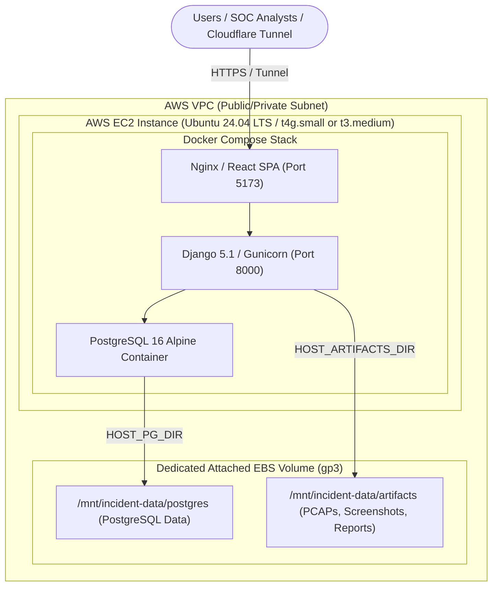

# AWS EC2 & Dedicated EBS Volume Deployment Guide

This guide walks through deploying the **SOC Incident Response Evidence & Timeline Reporter** on **Amazon Web Services (AWS)** using a cost-efficient, resilient architecture: a single **AWS EC2 instance** paired with a **dedicated persistent AWS EBS volume**.

---

## Architecture Overview



### Why This Architecture?
- **Cost Effective**: Costs ~\$15–\$25/month on a `t4g.small` (ARM Graviton) or `t3.medium` instance.
- **State Decoupling**: The OS root drive is completely stateless. All PostgreSQL tables and investigation artifacts live strictly on the dedicated EBS volume mounted to `/mnt/incident-data`.
- **Zero Data Loss on Replacement**: If the EC2 instance is terminated, resized, or upgraded, the EBS volume remains intact. You can re-attach it to any new EC2 instance and run `docker compose up -d` in minutes.
- **Instant Backups**: You can use AWS Data Lifecycle Manager (DLM) to take point-in-time EBS snapshots automatically without interrupting the application.

---

## Prerequisites

1. An **AWS Account** with permissions to launch EC2 instances and manage EBS volumes.
2. A **Domain name** managed via Cloudflare or Route 53 (if exposing via HTTPS).
3. An **SSH key pair** for EC2 access.

---

## Step 1: Provision AWS EC2 & Dedicated EBS Volume

### 1. Launch the EC2 Instance
- **AMI**: Ubuntu Server 24.04 LTS (64-bit x86 or ARM64).
- **Instance Type**: 
  - `t4g.small` (2 vCPU, 2 GiB RAM — ARM Graviton3, highly cost-efficient)
  - OR `t3.medium` (2 vCPU, 4 GiB RAM — x86)
- **Root Volume**: Default 20 GiB `gp3` (for OS, Docker binaries, and system packages).
- **Network / Security Group**:
  - Inbound SSH (Port 22) restricted to your IP.
  - If using **Cloudflare Tunnel (recommended)**: **No inbound web ports need to be open** (all outbound 443).
  - If using direct Nginx ingress: Allow Inbound Ports 80 and 443.
- **Availability Zone**: Take note of the exact AZ (e.g. `us-east-1a`).

### 2. Create the Dedicated EBS Data Volume
1. Go to **AWS Console > EC2 > Volumes > Create Volume**.
2. **Volume Type**: `gp3`.
3. **Size**: `20 GiB` to `100 GiB` (can be scaled up dynamically later without unmounting).
4. **Availability Zone**: **Must match your EC2 instance AZ** (e.g. `us-east-1a`).
5. **Tag**: `Name = incident-reporter-storage`.
6. Click **Create Volume**.

### 3. Attach the EBS Volume to Your Instance
1. In the AWS Volumes console, select your new volume.
2. Click **Actions > Attach Volume**.
3. Select your EC2 instance.
4. Set device name (e.g., `/dev/sdf` or `/dev/xvdf`).
5. Click **Attach**.

---

## Step 2: Initialize & Mount the Dedicated Storage Volume

Connect to your EC2 instance via SSH:
```bash
ssh -i /path/to/key.pem ubuntu@<EC2_PUBLIC_IP>
```

### 1. Identify the Attached Block Device
Run `lsblk` to locate the newly attached volume:
```bash
lsblk
```
*On AWS Nitro-based instances (t3, t4g, c5, etc.), `/dev/sdf` appears as `/dev/nvme1n1` or similar.*

### 2. Check and Format the Volume (First-Time Only)
Check whether the volume already has a filesystem:
```bash
sudo file -s /dev/nvme1n1
```
If the output shows `/dev/nvme1n1: data`, format it with `ext4`:
```bash
sudo mkfs -t ext4 /dev/nvme1n1
```
*(If attaching an existing EBS volume that already has data, **do not format** — proceed to mounting).*

### 3. Create the Mount Directory and Mount
```bash
sudo mkdir -p /mnt/incident-data
sudo mount /dev/nvme1n1 /mnt/incident-data
```

### 4. Configure Persistent Automount on Reboot (`/etc/fstab`)
Find the UUID of the storage device:
```bash
sudo blkid /dev/nvme1n1
```
Copy the `UUID="xxxx-xxxx-xxxx"` value. Edit `/etc/fstab`:
```bash
sudo nano /etc/fstab
```
Add the following line at the end:
```text
UUID=YOUR-VOLUME-UUID-HERE  /mnt/incident-data  ext4  defaults,nofail  0  2
```
Test that `/etc/fstab` mounts cleanly without errors:
```bash
sudo umount /mnt/incident-data
sudo mount -a
df -h /mnt/incident-data
```

### 5. Create Data Directories & Set Permissions
```bash
sudo mkdir -p /mnt/incident-data/postgres /mnt/incident-data/artifacts

# PostgreSQL runs under UID 999 inside postgres:16-alpine
sudo chown -R 999:999 /mnt/incident-data/postgres
sudo chmod 700 /mnt/incident-data/postgres

# Allow Docker container write permissions for artifacts
sudo chown -R ubuntu:ubuntu /mnt/incident-data/artifacts
sudo chmod 775 /mnt/incident-data/artifacts
```

---

## Step 3: Install Docker & Docker Compose

Run the following on your Ubuntu EC2 host:

```bash
# Update packages and install dependencies
sudo apt-get update
sudo apt-get install -y ca-certificates curl gnupg git

# Add Docker official GPG key
sudo install -m 0755 -d /etc/apt/keyrings
curl -fsSL https://download.docker.com/linux/ubuntu/gpg | sudo gpg --dearmor -o /etc/apt/keyrings/docker.gpg
sudo chmod a+r /etc/apt/keyrings/docker.gpg

# Add Docker repository
echo \
  "deb [arch=$(dpkg --print-architecture) signed-by=/etc/apt/keyrings/docker.gpg] https://download.docker.com/linux/ubuntu \
  $(. /etc/os-release && echo "$VERSION_CODENAME") stable" | \
  sudo tee /etc/apt/sources.list.d/docker.list > /dev/null

# Install Docker engine and Compose plugin
sudo apt-get update
sudo apt-get install -y docker-ce docker-ce-cli containerd.io docker-buildx-plugin docker-compose-plugin

# Allow current user to run docker without sudo
sudo usermod -aG docker $USER
newgrp docker
```

Verify installation:
```bash
docker compose version
```

---

## Step 4: Clone & Configure Incident Reporter

### 1. Clone Repository
```bash
cd /opt
sudo git clone https://github.com/aircooledcafe/incident-reporter.git
sudo chown -R ubuntu:ubuntu /opt/incident-reporter
cd /opt/incident-reporter
```

### 2. Configure Environment (`.env`)
```bash
cp .env.example .env
```

Generate a secure secret key:
```bash
python3 -c "import secrets; print(secrets.token_urlsafe(50))"
```

Edit `.env`:
```bash
nano .env
```

Set the following production configuration:
```ini
# ==============================================================================
# Production AWS EC2 Configuration
# ==============================================================================
DJANGO_SECRET_KEY=YOUR_GENERATED_SECRET_KEY_HERE
DJANGO_DEBUG=False
DJANGO_ALLOWED_HOSTS=*

# If using Cloudflare Tunnel or custom domain:
DJANGO_CSRF_TRUSTED_ORIGINS=https://soc.yourcompany.com,https://*.trycloudflare.com

# PostgreSQL Credentials
POSTGRES_DB=incident_reporter
POSTGRES_USER=soc_admin
POSTGRES_PASSWORD=GENERATE_STRONG_DATABASE_PASSWORD_HERE
POSTGRES_HOST=postgres
POSTGRES_PORT=5432

# Dedicated Attached EBS Storage Paths
HOST_PG_DIR=/mnt/incident-data/postgres
HOST_ARTIFACTS_DIR=/mnt/incident-data/artifacts

# Ports & Workers
APP_PORT=5173
BACKEND_PORT=8000
GUNICORN_WORKERS=3
```

---

## Step 5: Launch the Application

```bash
docker compose up -d --build
```

### Verify Service Status
```bash
docker compose ps
```
All 3 containers (`incident-reporter-db`, `incident-reporter-backend`, and `incident-reporter-frontend`) should show status `Up (healthy)`.

Check migration logs:
```bash
docker compose logs -f backend
```

---

## Step 6: Exposing Securely via Cloudflare Tunnel (Zero Open Ports)

Using **Cloudflare Tunnel (`cloudflared`)** eliminates the need to expose port 80/443 directly to the public internet or manage inbound Security Group rules.

### 1. Install `cloudflared` on the EC2 Host
```bash
curl -L --output cloudflared.deb https://github.com/cloudflare/cloudflared/releases/latest/download/cloudflared-linux-$(dpkg --print-architecture).deb
sudo dpkg -i cloudflared.deb
```

### 2. Authenticate & Create Tunnel
```bash
cloudflared tunnel login
cloudflared tunnel create incident-reporter
```

### 3. Route Domain Traffic
```bash
cloudflared tunnel route dns incident-reporter soc.yourcompany.com
```

### 4. Configure Tunnel
Create `/etc/cloudflared/config.yml`:
```yaml
tunnel: <TUNNEL_ID>
credentials-file: /etc/cloudflared/<TUNNEL_ID>.json

ingress:
  - hostname: soc.yourcompany.com
    service: http://127.0.0.1:5173
  - service: http_status:404
```

### 5. Install as a Systemd Service
```bash
sudo cloudflared service install
sudo systemctl enable --now cloudflared
```
The application is now accessible securely over HTTPS at `https://soc.yourcompany.com`.

---

## Step 7: Automated Backups & Disaster Recovery

### Automated EBS Snapshots via AWS DLM
1. Go to **AWS Console > EC2 > Lifecycle Manager**.
2. Click **Create Lifecycle Policy > EBS volume policy**.
3. Target volumes with tag: `Name = incident-reporter-storage`.
4. Configure Schedule:
   - Frequency: Daily at 02:00 UTC.
   - Retention: Keep last 14 snapshots.
5. Click **Create Policy**.

### Disaster Recovery: Moving to a New EC2 Instance
If the EC2 instance ever fails or needs replacement:
1. Launch a new EC2 instance.
2. In AWS Console, attach your existing EBS volume (`incident-reporter-storage`) to the new instance.
3. SSH into the new instance, mount `/mnt/incident-data` via `/etc/fstab`.
4. Install Docker, clone the repo, copy your `.env`, and run `docker compose up -d`.
5. All PostgreSQL databases, users, investigations, and uploaded artifacts are restored immediately with zero data loss.
