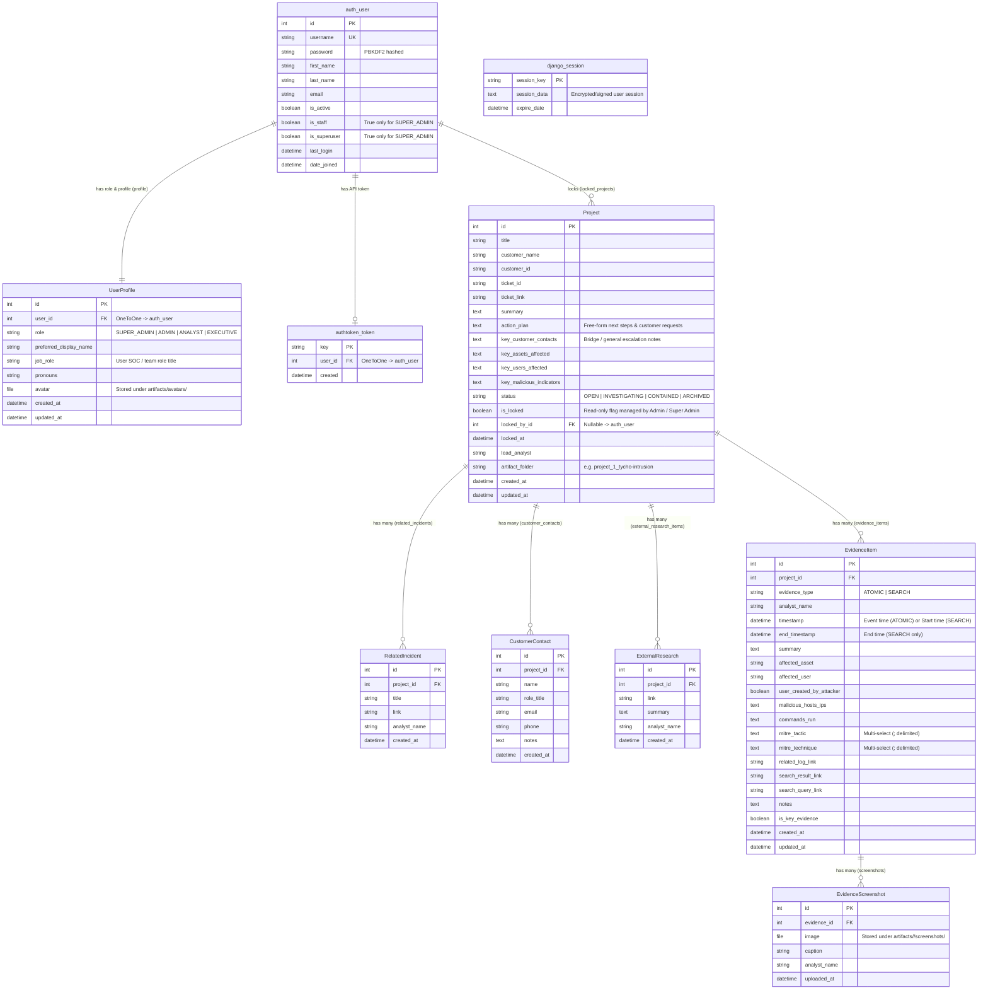

# SOC Investigations

A full-stack SOC investigation management, chronological evidence timeline construction, role-based access control, and investigation reporting application.

---

## Technology Stack & Pinned Versions

- **Backend**: Python (`>=3.10`) + **Django `5.1.14`** + Django Built-In Authentication (`django.contrib.auth`) + Django REST Framework (`3.17.2`) + `django-cors-headers` (`4.9.0`) + `odfpy` (`1.4.1`) + `Pillow` (`13.0.0`) + `gunicorn` (`23.0.0`)
- **Frontend**: **React `19.2.6`** (`react-dom@19.2.6`) + **`react-bootstrap@2.10.10`** + **`@restart/hooks@0.4.16`** + Vite (`6.x`) + Nginx (`1.27-alpine` in Docker)

---

## Key Features

1. **SOC Investigation Overview Homepage (Default View)**
   - Displays an at-a-glance overview of **current open investigations** by default, surfacing **Customer**, **Ticket Links**, **Related Escalated Incident Links**, **Investigation Summary**, and **Analyst Action Plan**, with green **New Investigation** action buttons.
   - Includes instant filter toggles for **Open**, **All**, **Archived**, and **Locked** investigations, plus ordering controls (**Chronological Newest/Oldest** and **Customer Name A→Z / Z→A**) and keyword search.

2. **Django Built-In Authentication, User Profiles & Four-Tier RBAC**
   - Backed directly by Django's `django.contrib.auth` (`auth_user`, password validators, database-backed `django_session`, and DRF `authtoken_token`) paired with `UserProfile` roles: **Super Admin**, **Admin**, **Analyst**, and **Executive**.
   - **User Name Dropdown Menu & Personalization**: The top navigation user button displays your **avatar**, **preferred display name**, and **role** (without cluttering the top bar with pronouns). Clicking your user name opens a dropdown for **Account, Avatar & Preferences**, **User & Role Management** (Admin / Super Admin), **Django Database Admin** (Super Admin), and **Sign Out**. Users can upload/remove a **profile avatar**, set a **preferred display name**, specify their **SOC role / job title** (`job_role`), and set **pronouns**.
   - **Investigation Locking (Read-Only Mode)**: **Admin** and **Super Admin** users can lock any investigation to freeze it as read-only (and unlock it when needed). Both **Locked** and **Archived** investigations are hidden from the workspace sidebar by default until toggled on.
   - **Super Admin Themed Demo Scenarios**: **Super Admin** accounts have exclusive access to **Load Sample Incident**, featuring four complete demonstration scenarios (*The Expanse* VPN/AD intrusion, *Star Trek* website compromise & web shells, *The Matrix* ClickFix to Domain Controller takeover, and *Star Wars* MitM phishing, spam wave & multi-account takeover).

3. **Investigation Workspace (`Overview`, `Evidence Timeline`, `Report Generation`)**
   - **Overview**: Supports **Title**, **Customer Name**, **Customer ID**, **Ticket ID**, **Ticket Link**, **Summary of Investigation**, **Action Plan** (free-form next steps, investigation areas, and customer requests), **Related Escalated Incidents** (titles + links), **Key Customer Contacts** (name, role/title, email, phone, notes + bridge notes), **Key Assets Affected**, **Key Users Affected**, **Key Malicious Indicators**, and **External Research** links & summaries.
   - Automatically provisions a dedicated archive folder (`artifacts/project_<id>_<slug>/`) containing `screenshots/`, `reports/`, and a live-synced `archive_manifest.json`.
   - Investigation status management (`Open / Triage`, `Investigating`, `Contained`, `Archived / Closed`) with a header status picker, confirmation warning when closing/archiving, and sidebar switches for **Show Archived** and **Show Locked**.

4. **Streamlined Evidence Timeline, Click-to-Inspect Detail Popup & MITRE Multi-Select**
   - **Clean Timeline View + Full Detail Popup**: The **Evidence Timeline** table focuses on **Key** status, **Timestamp (UTC)**, **Asset & User**, **Summary & Indicators**, and **Links**. Clicking any row opens a comprehensive **Evidence Item Details** popup displaying every recorded detail (analyst attribution, evidence type, timestamps, defanged assets/indicators/commands, MITRE ATT&CK Tactics & Techniques, links, and attached screenshots).
   - **MITRE ATT&CK Multi-Select Dropdowns**: Evidence items feature multi-select menus for Enterprise **MITRE Tactics** and **MITRE Techniques**, dynamically filtering relevant techniques for the selected tactic(s) and pairing them in report summary tables.
   - **Scoped Defanging**: Automatically defangs affected or malicious assets, hostnames, domains, files, IPs, and URLs (`192.168[.]1.1`, `domain[.]com`, `hxxps[:]//`, `payload[.]exe`) while keeping analyst-provided links intact and clickable.

5. **Investigation Report Exports & Standardized Filenames**
   - Exported files use the investigation's creation date and metadata in the format:
     `date_customer_id_ticket_investigation_id.<ext>` (e.g., `2026-10-30_CUST-100_INC-500_1.csv`), automatically omitting the ticket segment (`date_customer_id_investigation_id.<ext>`) when no ticket ID is present.
   - **Report 1 — Investigation Evidence Timeline (`.csv`)**: Time-ordered CSV export of **all** recorded investigation evidence items, including multi-selected MITRE ATT&CK Tactics and Techniques.
   - **Report 2 — Investigation Key Evidence Report (`.odt` OpenDocument Text & `.md` Markdown / `.zip`)**:
     - Includes **only items flagged as Key Evidence**, ordered chronologically, with embedded screenshots and three **Investigation Summary Tables at the bottom** (*Key Assets Affected*, *Key Malicious Indicators*, and *MITRE Tactics and Techniques*).
     - The Markdown export automatically creates a dedicated `key_evidence_screenshots_investigation_<id>/` folder alongside the `.md` report (also downloadable as a `.zip` bundle).

---

## Authentication & User Roles

Authentication uses Django's built-in `django.contrib.auth` session and password-hashing framework for the web interface, plus DRF Token authentication for automated SOC ingestion scripts. All endpoints and `/artifacts/` media downloads require an authenticated, active account.

### Role Hierarchy & Permissions Matrix

| Capability | Executive (`EXECUTIVE`) | Analyst (`ANALYST`) | Admin (`ADMIN`) | Super Admin (`SUPER_ADMIN`) |
| :--- | :---: | :---: | :---: | :---: |
| Sign in, sign out, & change own password | Yes | Yes | Yes | Yes |
| Upload avatar, set preferred display name, & set pronouns | Yes | Yes | Yes | Yes |
| View Homepage, projects, timelines, contacts, & screenshots | Yes | Yes | Yes | Yes |
| Export CSV, ODT, Markdown, & ZIP reports | Yes | Yes | Yes | Yes |
| Create projects & modify unlocked investigations / action plans | No | Yes | Yes | Yes |
| Generate API token & push via `/api/soc/ingest/` *(unlocked projects)* | No | Yes | Yes | Yes |
| **Lock / Unlock** projects (read-only toggle) | No | No | **Yes** | **Yes** |
| **Delete** projects *(must be unlocked first)* | No | No | **Yes** | **Yes** |
| Create **Analyst** & **Executive** users | No | No | **Yes** | **Yes** |
| Assign roles (`ANALYST` / `EXECUTIVE`), enable/disable, & reset passwords for lesser users | No | No | **Yes** | **Yes** |
| Create & manage **Admin** / **Super Admin** users | No | No | **No** | **Yes** |
| **Load Sample Incidents** (*Expanse*, *Star Trek*, *Matrix*, *Star Wars*) | No | No | **No** | **Yes** |
| Access Django `/admin/` raw database administration | No | No | **No** | **Yes** |

### Bootstrapping the Initial Super Admin Account

No credentials or secrets are hardcoded in the codebase. You can create the first **Super Admin** account using any of three methods:

1. **Interactive Web Setup (First Run)**: If the database has zero users, opening the web UI automatically displays an **Initial Super Admin Setup** screen. Once the first user is created, this setup endpoint (`/api/auth/setup/`) is permanently disabled.
2. **Environment Variables (Automated Docker Bootstrap)**: Set `DJANGO_SUPERUSER_USERNAME` and `DJANGO_SUPERUSER_PASSWORD` (and optional `DJANGO_SUPERUSER_EMAIL`) in `.env`. On container startup, `python manage.py ensure_superuser` idempotently creates the Super Admin account if it does not yet exist.
3. **Django CLI**:
   ```bash
   # In Docker:
   docker compose exec backend python manage.py createsuperuser

   # Locally:
   cd backend && .venv/bin/python manage.py createsuperuser
   ```
   Any user created via `createsuperuser` automatically receives the `SUPER_ADMIN` role profile.

---

## Database Structure Overview

All relational data—including Django's built-in user accounts, role profiles, active sessions, API tokens, projects, lock metadata, research links, timeline evidence, and screenshot references—is stored in the configured database (`DJANGO_DB_PATH`), while binary screenshots, exported reports, and JSON archive manifests are persisted in `DJANGO_ARTIFACTS_ROOT`.



### Storage & Relational Behavior
- **Built-In Auth + `UserProfile`**: Uses Django's native `auth_user` table with a `1:1` `UserProfile` table storing the application role (`SUPER_ADMIN`, `ADMIN`, `ANALYST`, `EXECUTIVE`). `is_staff` and `is_superuser` are automatically synchronized so **only** `SUPER_ADMIN` can access `/admin/` to make direct database changes.
- **Database-Backed Sessions & Tokens**: User login sessions (`django_session` via `SESSION_ENGINE = 'django.contrib.sessions.backends.db'`) and SOC ingestion API tokens (`authtoken_token`) live inside the SQLite database rather than container memory.
- **Cascading Cleanup & Disk Synchronization**:
  - `ExternalResearch` and `EvidenceItem` cascade on `Project` deletion; `EvidenceScreenshot` cascades on `EvidenceItem` deletion and removes its image file from disk.
  - Deleting an unlocked `Project` (Admin / Super Admin only) also cleans up its `artifacts/<project_folder>/` directory.
  - Saving a `Project`, `EvidenceItem`, `ExternalResearch`, or `EvidenceScreenshot` writes an updated `archive_manifest.json` snapshot into `artifacts/<project_folder>/`.

---

## Required Secrets & Environment Variables (`.env`)

Before starting the application (with Docker Compose or locally), copy `.env.example` to `.env` and set **`DJANGO_SECRET_KEY`**.

| Variable | Required | Default | Description |
| :--- | :---: | :--- | :--- |
| `DJANGO_SECRET_KEY` | **Yes** | *(None — refuses to start if unset)* | Cryptographic secret key used by Django for signing sessions, CSRF tokens, and password reset hashes. |
| `DJANGO_DEBUG` | No | `False` | Enables Django debug mode (`True` or `False`). Keep `False` in production/Docker. |
| `DJANGO_ALLOWED_HOSTS` | No | `*` | Comma-separated list of allowed hostnames/IPs (e.g., `localhost,127.0.0.1,192.168.1.50`). |
| `DJANGO_CSRF_TRUSTED_ORIGINS` | No | *(Empty)* | Comma-separated trusted origins when accessed via reverse proxy / HTTPS (e.g., `https://ir.corp.example`). |
| `HOST_DB_DIR` | No | `./data/db` | External/host directory mounted to `/data/db` in Docker (stores `db.sqlite3`, WAL/journal files, `auth_user`, `UserProfile`, `django_session`, `authtoken_token`, and all project/evidence tables). |
| `HOST_ARTIFACTS_DIR` | No | `./artifacts` | External/host directory mounted to `/data/artifacts` in Docker (stores all project folders, uploaded screenshots, manifests, and generated `.csv`/`.odt`/`.md`/`.zip` reports). |
| `DJANGO_SUPERUSER_USERNAME` | No | *(Empty)* | Optional initial Super Admin username created on startup by `ensure_superuser`. |
| `DJANGO_SUPERUSER_PASSWORD` | No | *(Empty)* | Optional initial Super Admin password created on startup by `ensure_superuser`. |
| `DJANGO_SUPERUSER_EMAIL` | No | *(Empty)* | Optional initial Super Admin email address. |
| `APP_PORT` | No | `5173` | Host port exposed by the Nginx frontend container in Docker Compose. |
| `BACKEND_PORT` | No | `8000` | Host port exposed by the Gunicorn backend container in Docker Compose. |
| `GUNICORN_WORKERS` | No | `3` | Number of Gunicorn worker processes inside the backend container. |

### Initial Secret Setup (One-Liner)
```bash
cp .env.example .env
python3 -c '
import pathlib, secrets
p = pathlib.Path(".env")
p.write_text(p.read_text().replace("DJANGO_SECRET_KEY=", f"DJANGO_SECRET_KEY={secrets.token_urlsafe(50)}"))
'
```
*(Alternatively, run `openssl rand -base64 48` and paste the output after `DJANGO_SECRET_KEY=` inside `.env`.)*

---

## Docker Deployment & Non-Ephemeral External Storage

The Docker Compose stack runs two services:
- **`backend`**: Python `3.12-slim` + Django `5.1.14` + Gunicorn (`backend/Dockerfile`), automatically running migrations and `ensure_superuser` via `backend/entrypoint.sh`.
- **`frontend`**: Multi-stage Node `22-alpine` build + Nginx `1.27-alpine` (`frontend/Dockerfile` & `frontend/nginx.conf`), serving the compiled React SPA and reverse-proxying `/api/`, `/artifacts/`, `/admin/`, and `/django-static/` to `backend` while preserving `Host` and scheme headers for CSRF/session cookies.

### Externalizing All Persistent State (Zero Ephemeral User Data)

All application and user-created state lives outside the containers via configurable volume mounts:

| External Host / NAS Path (`.env`) | Container Mount | Persisted Data |
| :--- | :--- | :--- |
| `HOST_DB_DIR` *(default `./data/db`)* | `/data/db` | `db.sqlite3` (and SQLite journal/WAL files): **`auth_user` table**, **`UserProfile` roles/display names/pronouns**, **`django_session` login sessions**, **`authtoken_token` API keys**, **`django_admin_log`**, **`Project`**, **`RelatedIncident`**, **`CustomerContact`**, **`ExternalResearch`**, **`EvidenceItem`**, and **`EvidenceScreenshot`** metadata. |
| `HOST_ARTIFACTS_DIR` *(default `./artifacts`)* | `/data/artifacts` | User profile **`avatars/`**, per-investigation folders (`project_<id>_<slug>/`), uploaded **`screenshots/`**, generated **`reports/`** (`.csv`, `.odt`, `.md`, `.zip`), and **`archive_manifest.json`**. |

To store data on an external disk, NAS/NFS share, or SAN mount (e.g., `/mnt/soc-storage`), set in `.env`:
```ini
HOST_DB_DIR=/mnt/soc-storage/incident-reporter/db
HOST_ARTIFACTS_DIR=/mnt/soc-storage/incident-reporter/artifacts
```

### 1. Build and Start with Docker Compose
```bash
git clone git@github.com:aircooledcafe/incident-reporter.git incident-reporter
cd incident-reporter

cp .env.example .env
# Set DJANGO_SECRET_KEY (and optional HOST_DB_DIR, HOST_ARTIFACTS_DIR, DJANGO_SUPERUSER_*)

docker compose up -d --build
```
- **Web Application (Nginx + React)**: `http://<SERVER_IP>:5173`
- **Super Admin Django DB Interface**: `http://<SERVER_IP>:5173/admin/` *(restricted strictly to `SUPER_ADMIN` accounts)*
- **Direct Backend API**: `http://<SERVER_IP>:8000/api/`

### 2. Updating Containers Without Data Loss
```bash
git pull
docker compose up -d --build
```
Rebuilding replaces only the stateless container images and automatically applies any new Django schema migrations against your external `db.sqlite3`.

---

## Local Development Guide (Without Docker)

### Prerequisites
- **Python** `3.10+`
- **Node.js** `18+` and **npm**

### 1. Backend Setup
```bash
cp .env.example .env
# Set DJANGO_SECRET_KEY in .env

cd backend
python3 -m venv .venv
source .venv/bin/activate
pip install -r requirements.txt
.venv/bin/python manage.py migrate
cd ..
```

### 2. Frontend Setup
```bash
cd frontend
npm install --legacy-peer-deps
cd ..
```

### 3. Start Locally
```bash
./start.sh
```
- **Frontend UI**: `http://localhost:5173`
- **Backend API**: `http://localhost:8000`

### 4. Automated Test Suite
Runs 14 comprehensive test cases covering defanging, authentication, initial setup bootstrap, user profile avatars/preferred display names/pronouns, Executive/Analyst/Admin/Super Admin RBAC boundaries, Super Admin-only 4-scenario sample incident seeding, `/admin/` database restriction, project locking/unlocking, action plans, related escalated incidents, customer contacts, multi-select MITRE ATT&CK summary pairing, project deletion cleanup, protected `/artifacts/` media serving, CSV/ODT/Markdown report generation, and SOC API token ingestion:
```bash
cd backend
.venv/bin/python manage.py test incidents
```

---

## Programmatic SOC Tool Ingestion API

External Python/Django SIEM, SOAR, or IDS scripts can push evidence into an **unlocked** project via `POST /api/soc/ingest/` using an **Analyst**, **Admin**, or **Super Admin** API Token (viewable/rotatable in the web UI by clicking your user name -> **Account, Avatar & Preferences -> Password & API Token**):

```bash
curl -X POST http://127.0.0.1:8000/api/soc/ingest/ \
  -H "Authorization: Token <YOUR_API_TOKEN>" \
  -H "Content-Type: application/json" \
  -d '{
    "ticket_id": "SOC-2026-9041",
    "evidence_type": "ATOMIC",
    "analyst_name": "James Holden",
    "timestamp": "2026-10-17T03:15:00Z",
    "summary": "Outbound C2 beacon blocked at perimeter firewall",
    "affected_asset": "DC-PROD-01 (10.20.0.10)",
    "malicious_hosts_ips": "45.155.205.109, c2.ceres-telemetry.net",
    "mitre_tactic": "Command and Control (TA0011)",
    "mitre_technique": "T1071.001 - Web Protocols",
    "related_log_link": "https://siem.internal.example/events/fw-99201",
    "is_key_evidence": true
  }'
```
